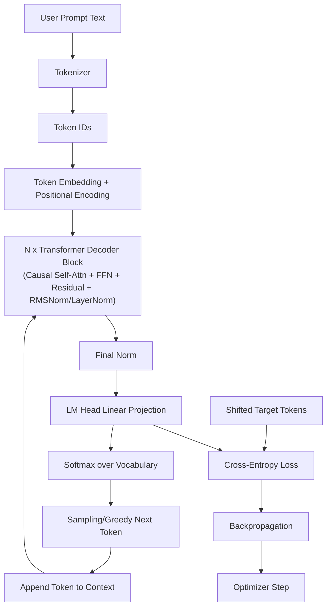

# Normal Decoder-Only LLM Architecture



# PCA Three-Phase Architecture (Current Repo Implementation)

```mermaid
flowchart TB
    A[Input IDs] --> B[Embedding + Position Embedding]
    B --> C["Encoder Stack<br/>(EncoderBlock x encoder_layers)"]

    subgraph LW[Latent Workspace / Imagination]
        C --> D[Latent Seed]
        C --> E[token_to_latent cross-attention]
        D --> E
        E --> F["Iterative Latent Refinement x imagination_steps<br/>latent self-attn + latent FFN + anchor mix"]
        F --> R["Optional RMS Alignment<br/>toward imagination_target_rms"]
        R --> G[Latent Memory]
    end

    subgraph DEC[Decoder / Rendering]
        H[Decoder Input IDs] --> I[Embedding + Position Embedding]
        I --> J["Decoder Stack<br/>(causal self-attn + cross-attn to Latent Memory + FFN)"]
        G --> J
        J --> K[Final RMSNorm]
        K --> L[LM Head]
        L --> M[Logits]
    end

    M --> N[Cross-Entropy Main Loss]
    F --> O["Imagination Aux Losses<br/>(stability + consistency + norm + contraction)"]
    N --> P[Total Loss]
    O --> P
    P --> Q[Backprop]
    Q --> S[Optimizer (current local three-phase presets use Muon)]
```