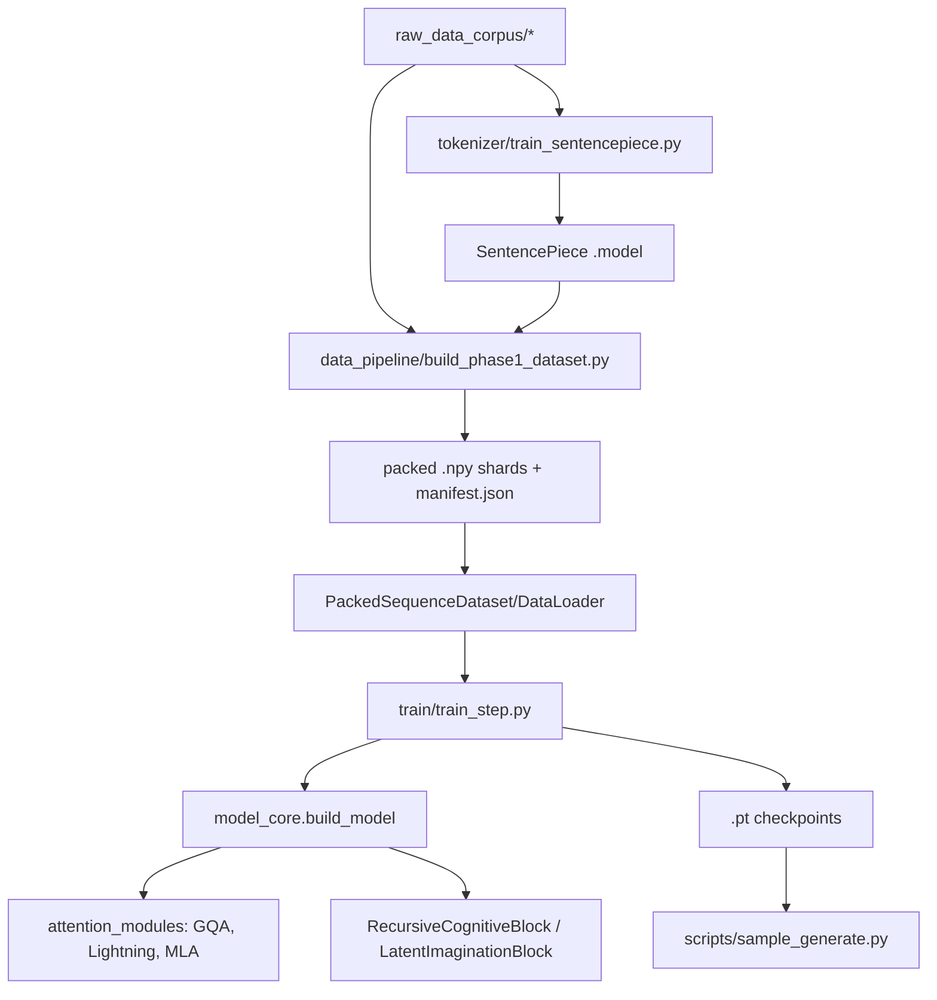

# PCA Codebase Audit Report

Audit date: 2026-06-24

Scope audited: Python source, JSON presets, README/config files, training/data/tokenizer scripts, and runtime smoke paths. Raw corpus files, generated `.npy` shards, and `.pt` checkpoints were inventoried as data artifacts but not line-by-line audited as code.

## 1. Executive Summary

This is a research-oriented Python/PyTorch ML codebase with a coherent high-level shape: attention modules, model cores, data preparation, tokenizer tooling, and training launchers. The main risk is not web-style attack surface; it is correctness/reproducibility risk in training and inference. The smoke scripts pass after installing dependencies, but they mostly verify shapes and finite tensors, leaving several edge cases uncovered: ignored multimodal masks, unvalidated dataset-builder arguments, token-id truncation, offset position crashes, and resume/checkpoint edge cases.

| Severity | Count |
|---|---:|
| Critical | 0 |
| High | 3 |
| Medium | 6 |
| Low | 4 |
| Cosmetic | 0 |

## 2. Architecture Overview

The repo is a single-process Python ML/research monolith. There is no HTTP backend, frontend, database layer, auth system, queue, cache, payment provider, or browser UI. Runtime entry points are CLI scripts.



Core model selection is centralized in `model_core/__init__.py` through `build_model(cfg)`, dispatching to `PCAModel`, `ThreePhasePCAModel`, or `MultimodalPCAModel`. The main autoregressive path stacks `TransformerBlock`s, applies optional imagination, then `RecursiveCognitiveBlock`, and finally `lm_head`.

## 3. Detailed Findings

### ID: 1
Title: Multimodal model ignores attention masks
Severity: High
Category: Logic / Data Integrity
Location: `model_core/multimodal_model.py:221-237`, `model_core/multimodal_model.py:151-154`, `model_core/multimodal_model.py:209-218`

Description: `MultimodalPCAModel.forward` accepts `attention_mask` and `decoder_attention_mask`, but deletes them. Encoder and decoder blocks are then called with `key_padding_mask=None`, so padded text tokens influence source encoding and text decoding.

Evidence:
```python
221: def forward(... attention_mask: Optional[torch.Tensor] = None, ...)
237:     del attention_mask, position_ids, aux_alpha_override, decoder_attention_mask
151: def _run_encoder(self, x: torch.Tensor) -> torch.Tensor:
153:     x = block(x, key_padding_mask=None, causal=False)
209: def _decode_text(...):
215:     self_key_padding_mask=None,
216:     memory_key_padding_mask=None,
```

Runtime probe: same input with all-ones mask vs. partial mask produced `multimodal_mask_max_abs_diff: 0.0`, proving masks do not affect logits.

Impact: Multimodal training treats padding as real content. Batches with different padding can contaminate latent states, decoder cross-attention, and learned text behavior.

Recommended Fix: Thread source and decoder masks through `_encode_sources`, `_run_encoder`, and `_decode_text`; build a combined key-padding mask for concatenated modalities; pass decoder padding masks to `DecoderBlock`.

Confidence: High.

### ID: 2
Title: `build_phase1_dataset.py --seq-len 0` can hang forever
Severity: High
Category: Reliability / Resource Exhaustion
Location: `data_pipeline/build_phase1_dataset.py:39-54`, `data_pipeline/build_phase1_dataset.py:172-178`

Description: CLI arguments do not validate `--seq-len` or `--shard-sequences`. With `--seq-len 0`, the packing loop condition is always true and `del buffer[:0]` removes nothing.

Evidence:
```python
44: parser.add_argument("--seq-len", type=int, default=8192)
45: parser.add_argument("--shard-sequences", type=int, default=1024)
172: for ids in result["encoded"]:
173:     buffer.extend(ids)
174:     while len(buffer) >= args.seq_len:
175:         seq = np.asarray(buffer[: args.seq_len], dtype=np.uint16)
176:         del buffer[: args.seq_len]
```

Impact: A bad CLI value can spin indefinitely during dataset generation, burning CPU and never writing a useful manifest.

Recommended Fix: Validate `seq_len > 0`, `shard_sequences > 0`, and `workers > 0` immediately after parsing.

Confidence: High.

### ID: 3
Title: Token IDs are stored as `uint16` and can silently wrap
Severity: High
Category: Data Integrity
Location: `data_pipeline/build_phase1_dataset.py:98-113`, `data_pipeline/build_phase1_dataset.py:172-176`, `requirements.txt:3`

Description: Dataset shards are forcibly saved as `np.uint16`. SentencePiece vocab size is configurable and not capped to 65,535, so token IDs above `65535` wrap modulo 65536 when cast.

Evidence:
```python
104: arr = np.stack(sequences, axis=0).astype(np.uint16, copy=False)
175: seq = np.asarray(buffer[: args.seq_len], dtype=np.uint16)
```

The tokenizer dependency is open-ended and the trainer accepts `--vocab-size`:
```text
requirements.txt:3: sentencepiece>=0.1.99
tokenizer/train_sentencepiece.py:123: parser.add_argument("--vocab-size", type=int, default=32000, ...)
```

Impact: Any experiment with vocab size above 65,536 can corrupt every affected training shard without an exception. The model then trains on wrong token IDs.

Recommended Fix: Use `np.uint32` or select dtype based on `sp.get_piece_size()`; fail loudly if the selected dtype cannot represent the tokenizer vocabulary.

Confidence: High.

### ID: 4
Title: Offset `position_ids` crash rotary embeddings
Severity: Medium
Category: Edge Case / Inference
Location: `attention_modules/gqa_rope/rope.py:52-70`, `attention_modules/gqa_rope/gqa_attention.py:63-69`

Description: `RotaryEmbedding.forward` builds a cache of length `seq_len`, then indexes that cache using `position_ids`. If callers pass offset positions such as `[[4, 5]]` for a two-token decode chunk, indexing fails.

Evidence:
```python
59: self._maybe_build_cache(seq_len=seq_len, device=device, dtype=dtype)
66: cos = self.cos_cached[0, 0].index_select(0, position_ids.reshape(-1))
```

Runtime probe: `rope(seq_len=2, position_ids=torch.tensor([[4,5]]))` raised `IndexError: index out of range in self`.

Impact: The public model API accepts `position_ids`, but cannot support common incremental decoding semantics where `position_ids` exceed the current chunk length.

Recommended Fix: Build the rotary cache to `max(position_ids) + 1` when `position_ids` is provided, capped/validated against `max_position_embeddings`.

Confidence: High.

### ID: 5
Title: `ModelConfig` allows odd attention head dimensions that later fail
Severity: Medium
Category: Validation
Location: `model_core/config.py:133-136`, `attention_modules/gqa_rope/rope.py:25-30`

Description: Config validation checks `d_model % n_heads == 0`, but does not require `head_dim` to be even. Rotary embeddings require an even dimension and raise later during model construction.

Evidence:
```python
133: if not _is_multiple(self.d_model, self.n_heads):
134:     raise ValueError("d_model must be divisible by n_heads")
```
```python
28: if dim % 2 != 0:
29:     raise ValueError("RotaryEmbedding dim must be even.")
```

Impact: Invalid configs fail after partially constructing model components, producing a less clear error path and making preset validation incomplete.

Recommended Fix: Add `if self.head_dim % 2 != 0: raise ValueError("head_dim must be even for RoPE")` in `ModelConfig.validate`.

Confidence: High.

### ID: 6
Title: Empty or too-small packed datasets crash the training loop
Severity: Medium
Category: Data Pipeline / Reliability
Location: `data_pipeline/build_phase1_dataset.py:190-217`, `data_pipeline/dataset_loader.py:27-33`, `train/train_step.py:638-643`

Description: The dataset builder can write a manifest with zero shards when inputs produce no full sequence. `PackedSequenceDataset` then has `total_sequences = 0`, and the training loop assumes `next(train_iter)` will eventually return a batch.

Evidence:
```python
190: if shard_sequences:
...
199: manifest = {
212:     "num_shards": len(shard_index),
213:     "shards": shard_index,
```
```python
27: self._shards = [np.load(...) for info in self.shard_infos]
33: self.total_sequences = total
```
```python
639: try:
640:     batch = next(train_iter)
641: except StopIteration:
642:     train_iter = iter(train_loader)
643:     batch = next(train_iter)
```

Impact: Small smoke datasets or overly strict filters can create a manifest that looks valid but causes training to fail with `StopIteration` instead of a clear data-quality error.

Recommended Fix: Make the builder fail if `len(shard_index) == 0`; make `create_packed_dataloader` reject zero-length datasets and `drop_last=True` datasets smaller than one batch.

Confidence: High.

### ID: 7
Title: Partial checkpoint-load fallback still fails on size mismatches
Severity: Medium
Category: Checkpointing / Maintainability
Location: `train/train_step.py:367-439`

Description: `load_checkpoint` catches a strict `load_state_dict` `RuntimeError` and retries with `strict=False`. In PyTorch, `strict=False` permits missing/unexpected keys but still raises for same-key shape mismatches, so architecture changes with renamed dimensions still crash before the JSON diagnostic can help.

Evidence:
```python
381: try:
382:     model.load_state_dict(payload["model_state"])
383: except RuntimeError as exc:
384:     incompat = model.load_state_dict(payload["model_state"], strict=False)
385:     reset_training_state = True
```

Impact: The intended model-structure-change recovery path is unreliable. Users changing dimensions or layer shapes may not get the promised partial-load/reset behavior.

Recommended Fix: Filter the checkpoint state dict to keys present in the current model with matching shapes before calling `load_state_dict(..., strict=False)`.

Confidence: High.

### ID: 8
Title: Math Unicode allowlist is mojibake and drops intended symbols
Severity: Medium
Category: Data Quality / Tokenizer
Location: `tokenizer/train_sentencepiece.py:11-16`, `tokenizer/train_sentencepiece.py:51-59`, `tokenizer/train_sentencepiece.py:63-69`

Description: The constant named `ALLOWED_MATH_UNICODE` contains mojibake text rather than the intended symbols. With `--ascii-only --allow-math-unicode`, real math symbols are not preserved.

Evidence:
```python
15: ALLOWED_MATH_UNICODE = set("ΣΔπθαβγμλ≈...")
51: if ascii_only:
57:     if ch in allowed_unicode_chars:
58:         continue
59:     return False
```

Runtime probe: `'Σ' in ALLOWED_MATH_UNICODE` returned `False`; sanitizing `"Σ Δ π θ ..."` did not preserve the intended characters.

Impact: Math/logical corpus text is silently stripped or distorted, undermining the tokenizer’s advertised reasoning/math support.

Recommended Fix: Save the file as UTF-8 and replace the mojibake literal with actual symbols, e.g. `set("ΣΔπθαβγμλ≈≠≤≥∞∫∑...")`; add a unit test for representative symbols.

Confidence: High.

### ID: 9
Title: Manifests can read arbitrary absolute or parent-relative local paths
Severity: Low
Category: Security / Privacy
Location: `data_pipeline/multimodal_dataset_loader.py:31-37`, `data_pipeline/multimodal_dataset_loader.py:163-168`

Description: Manifest paths are resolved as absolute paths when supplied, and relative paths are joined without preventing `..` traversal. A malicious or accidental manifest can cause the loader to read files outside the dataset root.

Evidence:
```python
31: def _resolve_path(path: str | None, base_dir: Path) -> Optional[Path]:
34:     p = Path(path)
35:     if not p.is_absolute():
36:         p = base_dir / p
37:     return p
```
```python
163: image_path = _resolve_path(row.get("image_path"), self.base_dir)
166: item["pixel_values"] = _load_image(image_path, self.image_size) if image_path else None
```

Impact: If manifests are shared or generated from untrusted sources, local files outside the dataset directory can be opened and processed.

Recommended Fix: Resolve paths and require `resolved_path.is_relative_to(base_dir.resolve())` unless an explicit `--allow-absolute-paths` option is set.

Confidence: High.

### ID: 10
Title: Manifest split shard sizes are not validated
Severity: Low
Category: Reliability
Location: `data_pipeline/create_manifest_split.py:13-22`, `data_pipeline/create_manifest_split.py:35-55`, `data_pipeline/create_manifest_split.py:120-135`

Description: `--train-shard-sequences` and `--eval-shard-sequences` are accepted as integers without validation. Passing `0` reaches `range(..., step=0)`.

Evidence:
```python
20: parser.add_argument("--train-shard-sequences", type=int, default=None)
21: parser.add_argument("--eval-shard-sequences", type=int, default=None)
50: for shard_id, start in enumerate(range(0, len(sequences), shard_sequences)):
```

Impact: Bad CLI input produces a Python `ValueError` rather than a clear CLI validation message.

Recommended Fix: Validate both shard sizes are positive before `write_split`.

Confidence: High.

### ID: 11
Title: Checkpoint writes are not atomic
Severity: Low
Category: Data Integrity / Operations
Location: `train/train_step.py:338-365`, `train/train_step.py:820-849`

Description: Checkpoints, including `last.pt`, are written directly with `torch.save`. If the process is interrupted during write, the path can be left corrupt and the launcher may auto-resume from it.

Evidence:
```python
351: path.parent.mkdir(parents=True, exist_ok=True)
364: torch.save(payload, path)
```
```python
836: final_ckpt = args.checkpoint_dir / "last.pt"
837: save_checkpoint(
```

Impact: Long training runs can lose the latest checkpoint and auto-resume can fail on a partially written `last.pt`.

Recommended Fix: Write to `path.with_suffix(path.suffix + ".tmp")`, fsync/close, then atomically replace with `Path.replace`.

Confidence: Medium; interruption timing is required to reproduce.

### ID: 12
Title: Untrusted checkpoints fall back to unsafe `torch.load` on older PyTorch
Severity: Low
Category: Security
Location: `train/train_step.py:376-379`, `scripts/sample_generate.py:147-150`, `requirements.txt:1`

Description: The code uses `weights_only=True` when available, but falls back to unrestricted `torch.load` on PyTorch versions that reject the argument. `requirements.txt` allows any `torch>=2.1.0`, so the fallback remains reachable in older supported environments.

Evidence:
```python
376: try:
377:     payload = torch.load(path, map_location=device, weights_only=True)
378: except TypeError:
379:     payload = torch.load(path, map_location=device)
```
```text
requirements.txt:1: torch>=2.1.0
```

Impact: Loading an untrusted checkpoint under an older supported PyTorch version can execute pickle payloads.

Recommended Fix: Require a PyTorch version with `weights_only` support, remove the unsafe fallback, and document that checkpoints must be trusted if optimizer/scaler state requires pickle loading.

Confidence: Medium because current audited environment installed torch 2.12.1 and used the safer path.

### ID: 13
Title: Test suite is smoke-script based and misses core invariants
Severity: Medium
Category: Testing
Location: `README.md:211-221`, `scripts/smoke_test_task3.py`, `scripts/smoke_test_task4.py`, `scripts/smoke_test_task5.py`, `scripts/smoke_test_task7.py`, `scripts/smoke_test_task8.py`, `scripts/smoke_test_task9.py`, `scripts/smoke_test_task10_three_phase_causality.py`, `scripts/smoke_test_multimodal_pca.py`

Description: The repository documents smoke scripts as tests. There is no formal `pytest`, `unittest`, or CI test configuration in the inventoried source. The scripts mostly print JSON reports and check shapes/finite outputs; they did not catch the mask, Unicode, dtype, or CLI-validation issues above.

Evidence:
```text
README.md:211: ## Testing
README.md:216: python scripts/smoke_test_task3.py  # Tokenizer
README.md:221: python scripts/smoke_test_task9.py  # Data pipeline
```

Observed inventory: `rg --files -g '*test*'` returned only `test_cmds.txt` and `scripts/smoke_test_*.py`.

Impact: Regressions in behavioral contracts can pass all current checks. This is especially risky for research code where small data-pipeline errors invalidate experiments.

Recommended Fix: Add a minimal `pytest` suite for config validation, rotary offset positions, multimodal mask behavior, dataset-builder argument validation, token dtype/vocab bounds, and checkpoint partial-load behavior.

Confidence: High.

## 4. Easily Missed Findings

These are the subtle issues most likely to survive normal smoke testing:

- ID 1: multimodal masks are accepted but deleted, producing identical logits regardless of padding mask.
- ID 3: token IDs silently wrap only when vocab exceeds `uint16`; defaults hide the bug.
- ID 4: rotary embeddings work for ordinary full-sequence calls but crash for offset `position_ids`.
- ID 6: empty manifests are allowed and fail later inside the train loop.
- ID 7: checkpoint fallback looks robust but repeats a PyTorch load mode that still rejects shape mismatches.
- ID 8: mojibake in the Unicode allowlist looks like “some Unicode” at a glance but is not the intended symbol set.

## 5. Security & Privacy Summary

Security exposure is limited because this is a local CLI ML repo with no server/auth/browser surface. Relevant findings:

- ID 9: multimodal manifests can point outside the dataset root and read arbitrary local paths.
- ID 12: older supported PyTorch versions can hit unsafe unrestricted checkpoint unpickling.
- No hardcoded API keys, database credentials, auth tokens, network listeners, CORS/CSRF surfaces, or web endpoints were found in the audited source.

## 6. Test Coverage Assessment

Commands run:

```text
python -m compileall -q attention_modules cognitive_router data_pipeline model_core scripts tokenizer train
python scripts\smoke_test_task3.py
python scripts\smoke_test_task4.py
python scripts\smoke_test_task5.py
python scripts\smoke_test_task7.py
python scripts\smoke_test_task8.py
python scripts\smoke_test_task9.py
python scripts\smoke_test_task10_three_phase_causality.py
python scripts\smoke_test_multimodal_pca.py
python train\train_step.py --steps 1 ... --checkpoint-dir tmp\audit_train_smoke
```

Observed result: dependency install succeeded; compileall passed; all smoke scripts passed; a tiny one-step CPU training run completed and wrote `tmp\audit_train_smoke\last.pt`.

Install observations:

```text
python -m pip install -r requirements.txt
Successfully installed ... torch-2.12.1 ... sentencepiece-0.2.1
WARNING: Cache entry deserialization failed, entry ignored
```

Highest-value next tests:

- Assert multimodal logits differ when masks exclude tokens.
- Assert `RotaryEmbedding` supports offset `position_ids`.
- Assert `build_phase1_dataset` rejects `seq_len <= 0`, `shard_sequences <= 0`, and oversized vocab/dtype combinations.
- Assert empty manifests fail at build/load time with clear errors.
- Assert checkpoint partial loading filters mismatched tensor shapes.
- Assert tokenizer math allowlist preserves representative Unicode symbols.

## 7. Prioritized Action Plan

1. Fix multimodal mask propagation (ID 1). This directly affects training correctness.
2. Fix dataset builder validation and token dtype selection (IDs 2 and 3). These can invalidate or hang data preparation.
3. Add the targeted pytest suite listed above (ID 13). It will lock in the fixes and prevent recurrence.
4. Fix rotary offset cache sizing and head-dim validation (IDs 4 and 5). These are small, high-confidence changes.
5. Harden empty-manifest handling and split argument validation (IDs 6 and 10).
6. Repair checkpoint partial-load and atomic checkpoint writes (IDs 7 and 11).
7. Repair tokenizer Unicode mojibake (ID 8).
8. Add path-root restrictions and checkpoint trust documentation (IDs 9 and 12).
