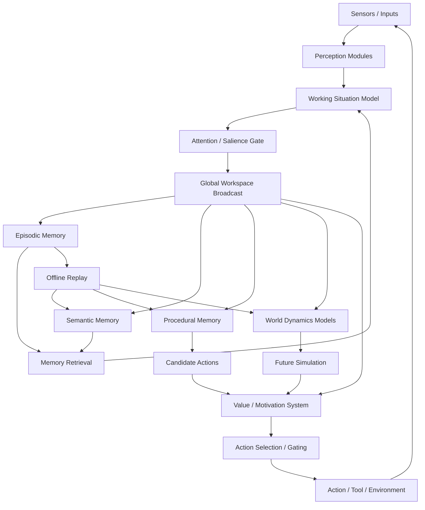

# 03 - AI Architecture Implications

This is the proposed direction for PCA if the project wants to become more brain-like instead of LLM-like.

## Design Position

Do not start from transformer scale. Start from cognition:

1. Perceive the world.
2. Maintain a current situation model.
3. Retrieve relevant memories.
4. Predict possible futures.
5. Select actions under goals and constraints.
6. Learn from outcomes.
7. Consolidate offline.

Language should be one interface and one cognitive tool, not the entire mind.

## Proposed PCA Brain-Inspired Loop

## Module Blueprint

### 1. Perception Modules

Purpose:

- Convert raw input into entities, relations, events, and affordances.
- Track "what changed" rather than reprocessing everything.

Implementation idea:

- text parser for language;
- visual/spatial parser for images or simulated environments;
- tool-state parser for code/editor/browser state;
- event detector for novelty and contradiction.

Brain inspiration:

- sensory cortex, hierarchical cortical processing, predictive coding.

### 2. Working Situation Model

Purpose:

- Hold the active state of the current problem.
- Keep goals, constraints, uncertainties, active entities, and recent events.

Implementation idea:

- small structured graph or blackboard;
- nodes for objects, agents, goals, actions, memories, uncertainties;
- TTL or decay for stale content.

Brain inspiration:

- prefrontal working memory and global workspace.

### 3. Attention / Salience Gate

Purpose:

- Decide which signals deserve global processing.
- Reduce compute by blocking irrelevant detail.

Implementation idea:

- salience score = novelty + goal relevance + uncertainty + risk + value + user priority;
- only high-score events are broadcast.

Brain inspiration:

- salience network, thalamic gating, attentional control.

### 4. Global Workspace

Purpose:

- Broadcast a small selected state to all major modules.
- Create a coherent "current thought" from many parallel processes.

Implementation idea:

- pub/sub event bus with a tiny active message;
- modules can propose updates and actions;
- workspace arbitrates conflicts.

Brain inspiration:

- global workspace theory, LIDA-style cognitive cycles.

### 5. Episodic Memory

Purpose:

- Store concrete experiences quickly.
- Preserve detail before abstraction destroys it.

Implementation idea:

- append-only event log;
- each episode stores timestamp, context, goal, action, observation, outcome, emotion/value, entities, embeddings, symbolic tags;
- sparse indexed keys for retrieval.

Brain inspiration:

- hippocampus, pattern separation, episodic replay.

### 6. Semantic Memory

Purpose:

- Store stable concepts, facts, schemas, and compressed regularities.

Implementation idea:

- graph database plus vector index;
- concept summaries produced from replay;
- contradiction tracking and confidence levels.

Brain inspiration:

- neocortex, slow consolidation, schemas.

### 7. Procedural Memory

Purpose:

- Store learned skills and habits.
- Avoid re-solving repeated tasks from scratch.

Implementation idea:

- scripts, policies, tool-use routines, code-generation templates, motor-like UI macros;
- chunking: compile successful deliberation into reusable procedures.

Brain inspiration:

- basal ganglia habit learning, cerebellar skill automation, Soar chunking.

### 8. World Dynamics Models

Purpose:

- Predict consequences of actions.
- Support simulation before action.

Implementation idea:

- learned transition models for domains;
- object and relation dynamics;
- causal rules;
- uncertainty estimates.

Brain inspiration:

- predictive processing, cerebellar forward models, hippocampal replay.

### 9. Value / Motivation System

Purpose:

- Decide what matters.
- Choose actions based on goals, rewards, risk, novelty, effort, and user intent.

Implementation idea:

- scalar and vector-valued reward signals;
- cost of compute and time;
- long-term preference memory;
- "do no harm" and user constraints as hard gates.

Brain inspiration:

- dopamine, basal ganglia, limbic motivation systems.

### 10. Offline Replay

Purpose:

- Learn while not actively acting.
- Convert episodes into semantic knowledge and skills.

Implementation idea:

- nightly/background jobs;
- sample surprising, failed, high-reward, and user-corrected episodes;
- update semantic memory, procedures, and world models.

Brain inspiration:

- sleep replay and systems consolidation.

## Why This Is Different From An LLM Agent Wrapper

An LLM agent wrapper usually:

- sends a prompt to a model;
- retrieves text chunks;
- calls tools;
- appends more text;
- repeats.

A brain-inspired PCA should:

- maintain persistent structured state;
- store detailed episodes;
- replay and consolidate;
- use action-grounded world models;
- use sparse module routing;
- distinguish semantic, episodic, procedural, and working memory;
- evaluate actions through value and risk gates;
- learn new skills from repeated success.

## Minimum Viable Architecture

The smallest worthwhile prototype could be:

1. `workspace`: structured current situation graph.
2. `episodic_memory`: append-only event store.
3. `semantic_memory`: distilled facts and schemas.
4. `retrieval`: pattern completion from partial cues.
5. `planner`: candidate actions.
6. `value_gate`: selects or rejects actions.
7. `replay`: offline consolidation job.

This can be built with normal software first. Neuromorphic or spiking components can come later.

## First Experiment: Toddler-Task Cognitive Battery

Build simple simulated tasks where LLMs are brittle:

- object permanence: hidden object remains in scene;
- containment: object inside box moves with box;
- support: unsupported object falls;
- tool affordance: stick can pull item, cloth can drag item;
- spatial relations: left/right/above/below with multi-hop changes;
- conservation/counting: small sets of objects remain same under rearrangement;
- goal persistence: interrupted task resumes after distraction.

Metrics:

- sample efficiency;
- correction after one failure;
- memory retention after delay;
- transfer to new layouts;
- compute cost per episode;
- explanation quality after action.

## Second Experiment: Memory Consolidation

Run an agent through repeated small tasks. Store episodes. Let replay compress them into rules.

Expected result:

- first attempts require deliberation;
- later attempts retrieve procedures;
- semantic rules become more stable;
- similar episodes are separated when needed, generalized when safe.

## Third Experiment: Sparse Routing

Track how many modules activate per task. Add salience gating.

Expected result:

- easy repeated tasks activate fewer modules;
- surprising failures trigger broader broadcast;
- compute per successful task decreases over time.

## Research Hypothesis

PCA will become more generally intelligent by integrating specialized memory and control systems than by only increasing model size.
